# Culture City Edition

**Culture City Edition** von **ps-mdt** und **ps-dispatch** für FiveM (QBCore).

Autor: Robertbox28 · robertbox28.ch · Für Culture City

---

## Inhalt

| Ordner | Was es ist |
|---|---|
| `ps-mdt/` | Das MDT mit eigenen Oberflächen für Polizei, Rettungsdienst, LSFD, Justiz, Regierung, Taxi und East Customs |
| `ps-dispatch/` | Die Leitstelle, abgestimmt auf das MDT, mit Auftrags-Dispatch für Taxi (`/taxi`) und Mechaniker (`/mechaniker`) |
| `Anleitung/` | Anleitung als Webseite mit Live-Vorschau des MDT (`Anleitung/index.html` im Browser öffnen) |
| `CHANGELOG.md` | Alle Änderungen |

## Funktionen

- Eigene Oberflächen mit Farben und Logos für jede Behörde
- Komplett auf Deutsch
- Eigene GTA-V-Karte mit Roxwood und Cayo Perico, inklusive Einsatzmarkierungen
- Besetzung: wer mit wem in welchem Fahrzeug arbeitet
- Bussgeldkatalog von Culture City als Strafgesetzbuch (128 Tatbestände)
- Eingebaute Dienstanweisungen für alle Behörden
- Telefonnummern aus LB Phone
- Profile, Personalprotokolle und Dienstzeiten getrennt pro Behörde

## Vorschau

Die Bilder stammen aus der Vorschau mit Testdaten. Eine Live-Vorschau, in der man zwischen allen Behörden wechseln kann, liegt unter `Anleitung/vorschau/index.html` (im Browser öffnen).

### Oberflächen

| Polizei | Rettungsdienst |
|---|---|
| 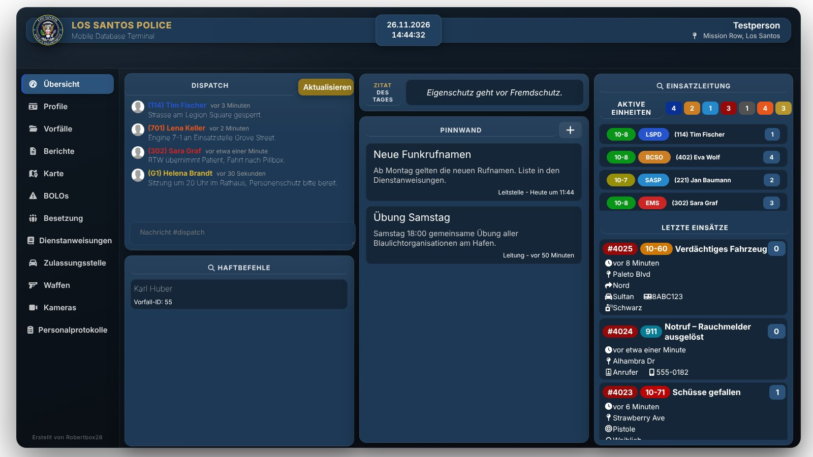 | 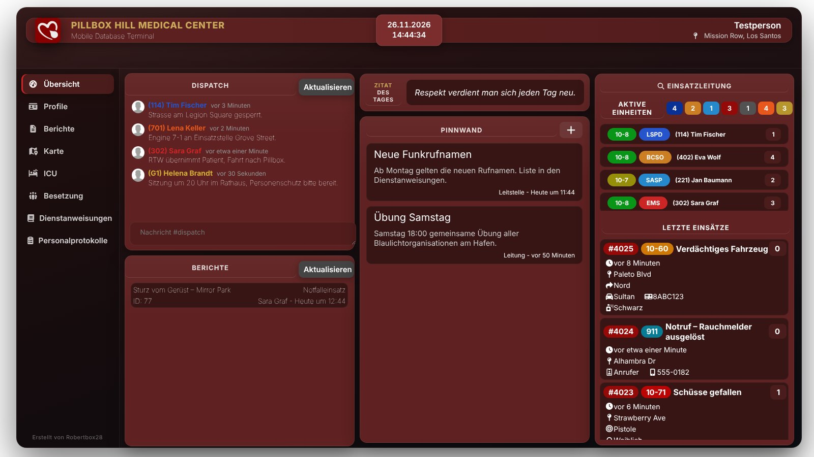 |
| **LSFD** | **Justiz** |
| 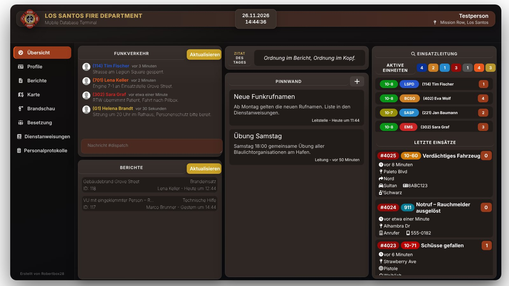 | 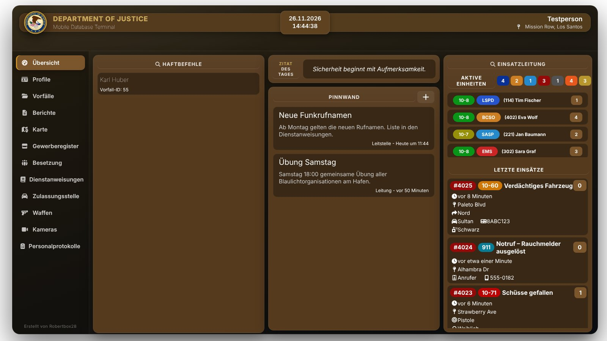 |
| **Regierung** | **Taxi** |
| 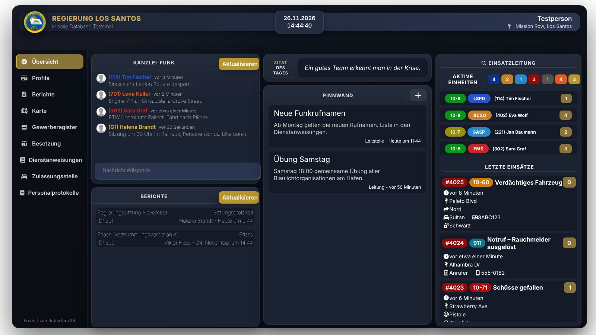 | 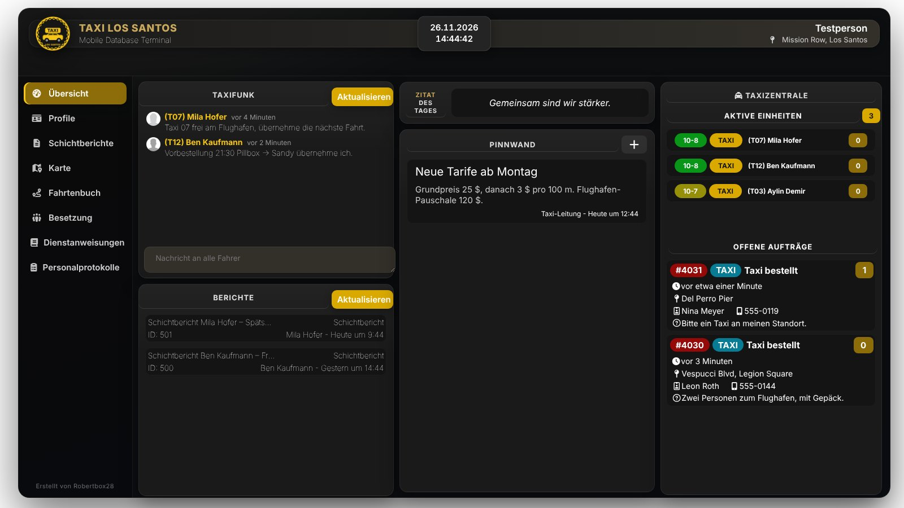 |
| **East Customs** | |
| 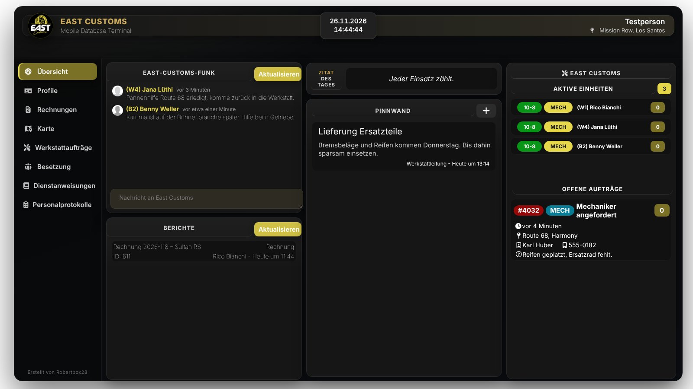 | |

### Funktionen

| Besetzung | Dienstanweisungen |
|---|---|
| 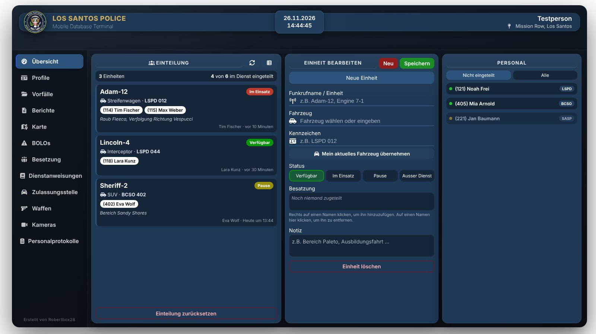 | 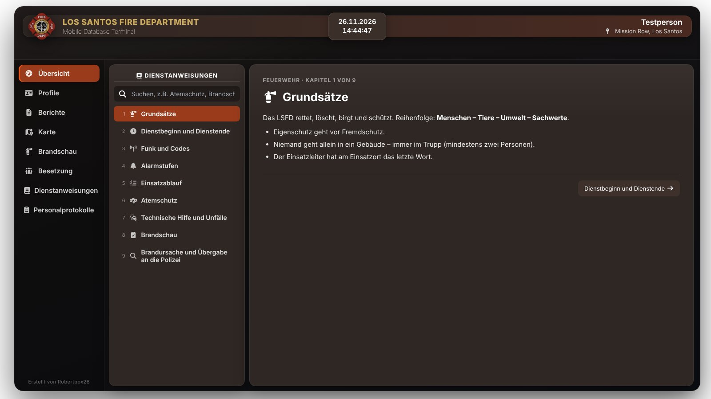 |
| **Gewerberegister (Regierung)** | **Werkstattaufträge (East Customs)** |
| 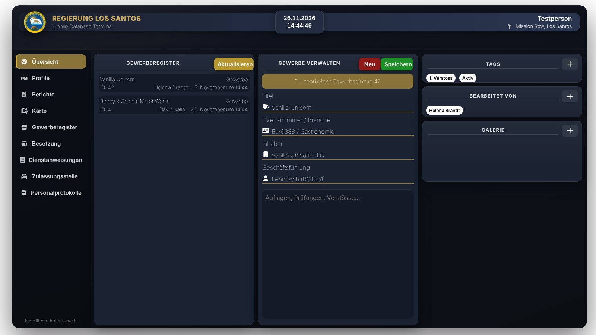 | 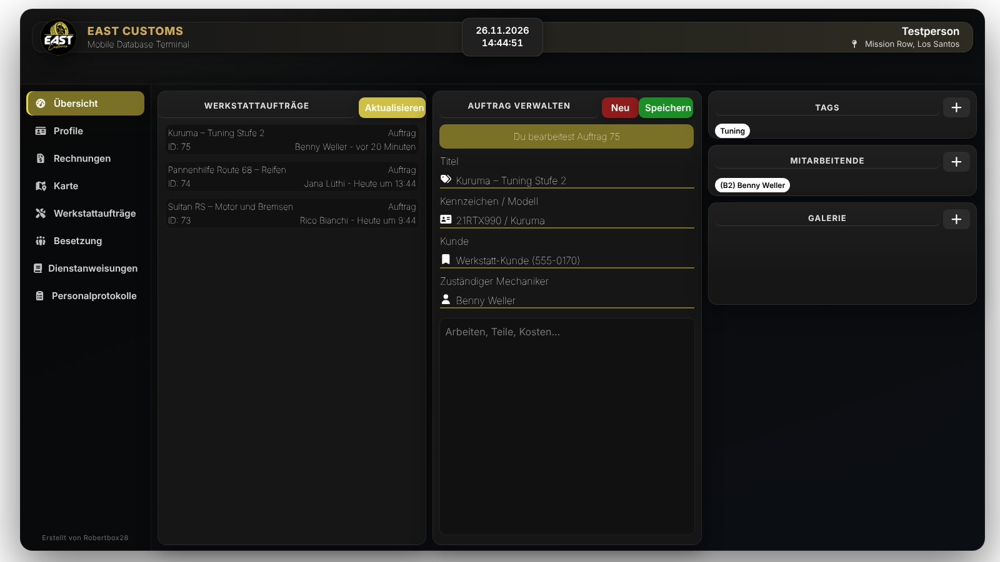 |

### Leitstelle

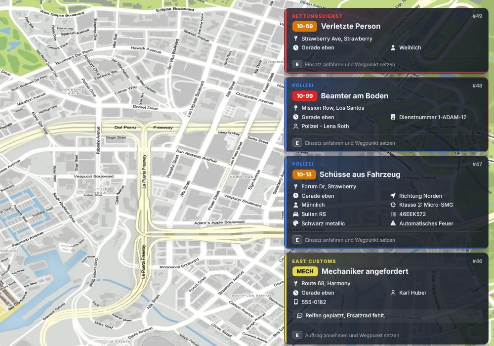

## Voraussetzungen

- QBCore
- oxmysql
- LB Phone (optional, sonst wird die QBCore-Nummer verwendet)
- screenshot-basic (für Polizeifotos)

## Installation

1. Die Ordner `ps-mdt` und `ps-dispatch` in den `resources`-Ordner kopieren.
2. `ps-mdt/mdt.sql` in die Datenbank importieren. Bestehende Tabellen werden beim ersten Start automatisch angepasst.
3. In der `server.cfg` sicherstellen, dass beide Resources gestartet werden:
   ```
   ensure ps-dispatch
   ensure ps-mdt
   ```
4. Konfiguration ausfüllen (siehe unten).
5. Server neu starten oder in der Konsole `refresh`, `restart ps-dispatch` und `restart ps-mdt` ausführen.

## Konfiguration

In diesem Repository sind **keine Webhooks und keine Links** eingetragen. Folgende Werte müssen auf dem Server selbst gesetzt werden:

| Datei | Einstellung | Inhalt |
|---|---|---|
| `ps-mdt/shared/config.lua` | `Config.MugShotWebhook` | Discord-Webhook für Polizeifotos |
| `ps-mdt/shared/config.lua` | `Config.ClockinWebhook` | Discord-Webhook für Dienstbeginn und Dienstende |
| `ps-mdt/shared/config.lua` | `Config.sopLink` | Optional: Link zu externen Dienstanweisungen pro Job |
| `ps-mdt/shared/config.lua` | `Config.RosterLink` | Optional: Link zu einem externen Dienstplan pro Job |

Webhooks bitte **nie** ins Repository hochladen. Wer einen Webhook kennt, kann damit Nachrichten in euren Discord schreiben.

Die Jobnamen der Behörden stehen in `ps-mdt/shared/config.lua` (`Config.PoliceJobs`, `Config.GovJobs`, `Config.TaxiJobs` usw.) und in `ps-dispatch/config.lua` (`Config.AuthorizedJobs`). Neue Jobs immer an beiden Stellen eintragen. Alle Einstellungen sind in der Anleitung beschrieben.

## Lizenz und Grundlage

Beide Resources basieren auf [ps-mdt](https://github.com/Project-Sloth/ps-mdt) und [ps-dispatch](https://github.com/Project-Sloth/ps-dispatch) von Project Sloth und stehen wie das Original unter der **GNU GPL v3** (siehe `LICENSE` in den Ordnern). Änderungen müssen ebenfalls unter der GPL v3 weitergegeben werden.
